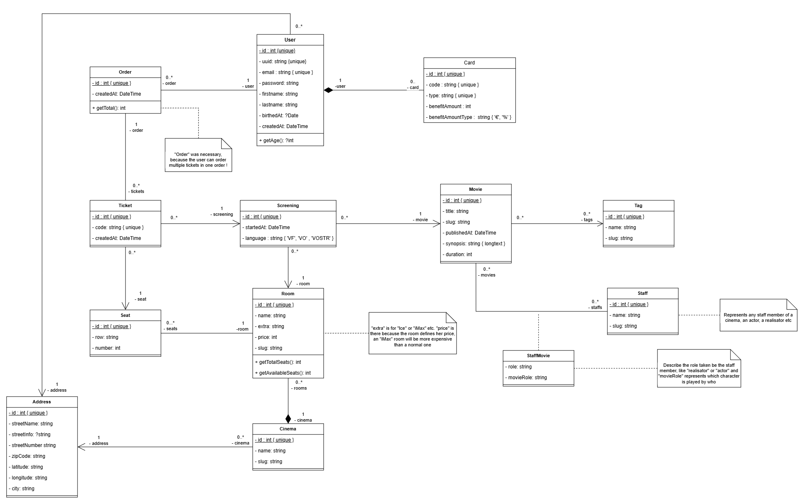

# Exo SQL avancé — Billetterie de cinéma

> ⚠️ Deux noms viennent de l'UML et sont des **mots réservés SQL** : ils doivent
> **toujours** être écrits entre backticks → la table `` `order` `` et la colonne `` `row` `` (table `seat`).



## Triggers

### 1. Mettre à jour automatiquement la date de modification d'un film

Avant de faire ce trigger vous devez passer cette requête :
```sql
ALTER TABLE movie
ADD COLUMN updated_at DATETIME DEFAULT NULL;
```

Faire un **trigger** `BEFORE UPDATE` sur `movie` qui met automatiquement la colonne `updated_at`
à la date courante à chaque modification de la fiche film (back-office).


```sql
DELIMITER $$
CREATE TRIGGER movie_before_update BEFORE UPDATE
ON movie FOR EACH ROW
BEGIN
    SET NEW.updated_at = NOW();
END $$
DELIMITER ;
```

### 2. Générer automatiquement le code d'un billet

Faire un **trigger** `BEFORE INSERT` sur `ticket` qui, si la colonne `code` est vide (`NULL` ou `''`),
la remplit automatiquement au format `TCK-<screening_id>-<seat_id>` (ex : `TCK-42-1057`).
- On en profite pour positionner `created_at = NOW()` si aucune date n'est fournie.

```sql
DELIMITER $$
DROP TRIGGER IF EXISTS ticket_before_insert $$
CREATE TRIGGER ticket_before_insert BEFORE INSERT
ON ticket FOR EACH ROW
BEGIN
    IF NEW.code IS NULL OR NEW.code = "" THEN
	   	SET NEW.code = CONCAT("TCK-", NEW.screening_id, "-", NEW.seat_id);
    END IF;
END $$
DELIMITER ;
```

---

## Procédures stockées

### 1. Total d'une commande — `getOrderTotal`

Faire une **procédure stockée** qui prend en paramètre un **id de commande** (`order`) et affiche
le **montant total** de cette commande.
- Le prix d'un billet est celui de la **salle** de la séance (`room.price`, via `ticket → screening → room`).
- Afficher le total au format `"xx,xx€"` (les prix sont stockés en **centimes**).
- Sert à la page **panier / confirmation de commande**.

```sql
DELIMITER $$
DROP PROCEDURE IF EXISTS getOrderTotal $$
CREATE PROCEDURE getOrderTotal(orderId INT)
BEGIN
    SELECT CONCAT(FORMAT(SUM(r.price)/100, 2), '€')
    FROM `order` AS o
    LEFT JOIN ticket AS t ON t.order_id = o.id
    LEFT JOIN screening AS s ON s.id = t.screening_id
    LEFT JOIN room AS r ON r.id = s.room_id
    WHERE o.id = orderId;
END $$
DELIMITER ;
```

### 2. Places disponibles d'une séance — `getAvailableSeats`

Faire une **procédure stockée** qui prend en paramètre un **id de séance** et affiche le **nombre de places encore disponibles**.
- Disponibles = capacité de la salle (nombre de `seat`) − nombre de billets déjà vendus pour cette séance.
- Sert à l'**API de la page séance** (activer/désactiver le bouton « Réserver »).
- **Bonus** : faire une variante qui **liste les sièges libres** (`row` + `number`) plutôt que de les compter.

```sql
SET @idScreening = 5;

SET @totalSeat = (
    SELECT COUNT(*)
    FROM seat s
    LEFT JOIN room r ON r.id = s.room_id
    LEFT JOIN screening sc ON r.id = sc.room_id
    WHERE sc.id = @idScreening
);

SELECT
	@totalSeat AS totalSeat,
    COUNT(*) AS useSeat,
    (@totalSeat - COUNT(*)) AS availableSeat

FROM ticket t
JOIN seat s ON s.id = t.seat_id
JOIN room r ON r.id = s.room_id
WHERE t.screening_id = @idScreening;
```

```sql
DELIMITER //
DROP PROCEDURE IF EXISTS getAvailableSeats //
CREATE PROCEDURE getAvailableSeats(idScreening INT)
BEGIN
    SELECT
        (SELECT COUNT(*) FROM seat WHERE room_id = s.room_id) AS total_places,
        (SELECT COUNT(*) FROM ticket WHERE screening_id = s.id) AS places_prises,
        (
            (SELECT COUNT(*) FROM seat WHERE room_id = s.room_id)
                -
            (SELECT COUNT(*) FROM ticket WHERE screening_id = s.id)
        ) AS places_disponibles
    FROM screening s
    WHERE s.id = 5;
END //
DELIMITER ;
```

### 3. Récapitulatif d'un utilisateur — `getUserSummary`

Faire une **procédure stockée** qui prend en paramètre un **id d'utilisateur** et affiche
son **nombre de commandes** et le **total dépensé** (au format `"xx,xx€"`).
- Sert à l'**espace client** et au back-office marketing.

```sql
DELIMITER //
DROP PROCEDURE IF EXISTS getUserSummary //
CREATE PROCEDURE getUserSummary(userId INT)
BEGIN
    SELECT u.first_name, u.last_name, COUNT(DISTINCT o.id) nb_order, CONCAT(FORMAT(SUM(r.price)/100, 2, "fr_FR"), "€") total
    FROM `user` u
    JOIN `order` o ON o.user_id = u.id
    JOIN ticket t ON t.order_id = o.id
    JOIN screening s ON s.id = t.screening_id
    JOIN room r ON r.id = s.room_id
    WHERE u.id = userId;
END //
DELIMITER ;
```

---

## Transaction

### Réservation de plusieurs places

Avant cet exercice, on protège la base contre la double réservation avec une **contrainte** :
```sql
ALTER TABLE ticket
ADD CONSTRAINT uq_ticket_seat_screening UNIQUE (screening_id, seat_id);
```

Écrire une **transaction** qui réserve plusieurs places pour une même séance :
1. créer une nouvelle ligne dans `` `order` `` pour l'utilisateur ;
2. insérer un `ticket` par siège choisi.

- Tester un scénario qui **réussit** (sièges libres) et un scénario qui **échoue** (au moins un siège déjà vendu).

```sql
START TRANSACTION;
INSERT INTO `order` VALUES (NULL, NOW(), 1);
SET @orderId = LAST_INSERT_ID();
INSERT INTO ticket VALUES (NULL, NULL, NOW(), @orderId, 12, 3);
INSERT INTO ticket VALUES (NULL, NULL, NOW(), @orderId, 12, 4);
INSERT INTO ticket VALUES (NULL, NULL, NOW(), @orderId, 12, 5);
COMMIT;
```

---

## Requêtes

> L'objectif : écrire les requêtes qui alimentent réellement **les pages du site** et **les réponses JSON de l'API**.

### 1. (Page d'accueil — à l'affiche)
Afficher les films qui ont **au moins une séance à venir** (`started_at >= NOW()`),
avec leur titre, leur durée et le **nombre de séances à venir**. Trier par nombre de séances décroissant.

```sql
SELECT m.title, m.duration, COUNT(s.id) nb_screenings FROM `movie` m
JOIN screening s ON s.movie_id = m.id
WHERE s.started_at >= NOW()
GROUP BY s.movie_id
ORDER BY nb_screenings DESC;
```

### 2. (Fiche film — en-tête)
Pour un film donné, afficher son titre, sa durée, son synopsis, la **liste de ses genres** concaténée
sur une seule ligne (ex : `"Science-Fiction, Action, Aventure"`) et le **nom de son réalisateur**.

```sql
SELECT m.title, m.duration, m.synopsis, GROUP_CONCAT(tag.name), staff.name
FROM `movie` m
JOIN movie_tag ON movie_tag.movie_id = m.id
JOIN tag ON tag.id = movie_tag.tag_id
JOIN staff_movie ON staff_movie.movie_id = m.id
JOIN staff ON staff.id = staff_movie.staff_id
WHERE staff_movie.role = 'director'
GROUP BY m.id;
```

### 3. (Fiche film — casting)
Pour un film donné, afficher la liste de ses **acteurs** (`staff.name`) avec le **personnage** joué
(`staff_movie.movie_role`). N'afficher que les membres dont le rôle est `actor`.

```sql
SELECT m.title, staff.name, staff_movie.role
FROM staff_movie
JOIN staff ON staff_movie.staff_id = staff.id
JOIN `movie` m ON m.id = staff_movie.movie_id
WHERE m.id = 1
AND staff_movie.role = 'actor';
```

### 4. (Fiche film — séances)
Pour un film donné, afficher ses **prochaines séances** : date/heure, langue, nom du cinéma et nom de la salle.
Trier par date croissante.

```sql
SELECT m.title, s.started_at, s.language, c.name theater, r.name room FROM `movie` m
JOIN screening s ON s.movie_id = m.id
JOIN room r ON r.id = s.room_id
JOIN cinema c ON c.id = r.cinema_id
WHERE s.started_at >= NOW()
AND m.id = 1;
```

### 5. (Page cinéma — programme)
Pour un cinéma donné, afficher le **programme des séances à venir** : titre du film, date/heure,
salle et langue. Trier par film puis par date.

```sql
SELECT m.title, s.started_at, s.language, c.name theater, r.name room
FROM `screening` s
JOIN room r ON r.id = s.room_id
JOIN cinema c ON c.id = r.cinema_id
JOIN movie m ON m.id = s.movie_id
WHERE c.id = 1
ORDER BY s.started_at DESC, m.title ASC;
```

### 6. (Page séance — plan de salle)
Pour une séance donnée, afficher **tous les sièges de la salle** avec leur statut :
le `row`, le `number`, et `"Occupé"` ou `"Libre"` selon qu'un billet existe ou non pour ce siège sur cette séance.

> Solution 1

```sql
SELECT 	
		CONCAT(s.row, '', s.number),
        IF(
            ticket.id IS NOT NULL,
            'Occupé',
            'Libre'
        )
FROM seat
JOIN screening s
	ON s.room_id = seat.room_id
LEFT JOIN ticket
	ON ticket.seat_id = seat.id
    AND ticket.screening_id = s.id
WHERE s.id = 5;
```
> Solution 2

```sql
SELECT
	CONCAT(s.row, '', s.number),
    IF(
        s.id IN (
            SELECT s.id
            FROM seat s
            LEFT JOIN screening sc ON sc.room_id = s.room_id
            JOIN ticket t ON t.seat_id = s.id
            WHERE sc.id = 5 AND t.screening_id = 5
        ),
        "Occupé",
        "Libre"
    )
FROM seat s
LEFT JOIN screening sc ON sc.room_id = s.room_id
WHERE sc.id = 5;
```

### 7. (Billet / confirmation de commande)
Afficher le **détail d'une commande** : pour chaque billet → titre du film, date de la séance,
cinéma, salle, place (`row` + `number`) et **prix unitaire** au format `"xx,xx€"`.

```sql
SELECT m.title, screening.started_at, c.name theater, r.name room, CONCAT(s.row, ' ', s.number) seat, CONCAT(FORMAT(r.price/100, 2, "fr_FR"), '€')
FROM `order` o
JOIN ticket t ON t.order_id = o.id
JOIN screening ON screening.id = t.screening_id
JOIN movie m ON m.id = screening.movie_id
JOIN room r ON r.id = screening.room_id
JOIN cinema c ON c.id = r.cinema_id
JOIN seat s ON s.id = t.seat_id
WHERE o.id = 1;
```

### 8. (Espace client — mes commandes)
Pour un utilisateur donné, afficher l'**historique de ses commandes** : numéro (id) de commande,
date, **nombre de places** et **montant total** de la commande au format `"xx,xx€"`. Trier par date décroissante.

### 9. (API — top films)
Afficher le **top 10 des films les plus vendus** (en nombre de billets vendus), avec le titre et le total de billets.

### 10. (Dashboard — chiffre d'affaires par cinéma)
Afficher, par **cinéma**, le **chiffre d'affaires** généré (somme des prix des billets vendus),
au format `"xx,xx€"`. Trier du plus gros au plus petit.

### 11. (Dashboard — taux de remplissage)
Afficher, pour chaque séance **passée**, son **taux de remplissage** en pourcentage
(`billets vendus / capacité de la salle * 100`). Afficher film, date et taux. Trier par taux décroissant.

### 12. (Dashboard — CA par genre)
Afficher le **chiffre d'affaires par genre** (`tag`), au format `"xx,xx€"`, trié décroissant.
- Attention : un film ayant plusieurs genres compte dans chacun de ses genres.

### 13. (API — répartition des langues)
Afficher la **répartition des séances par langue** (`VF`, `VO`, `VOSTR`) : la langue et le nombre de séances.

### 14. (Marketing — relance)
Afficher les utilisateurs **n'ayant jamais passé de commande** (peut être 0 !) :
email, nom et prénom. *Cible d'une campagne de relance.*

### 15. (Stat — inscriptions par domaine)
Compter les utilisateurs regroupés par **domaine d'email** (ex : `"gmail.com"`, `"yahoo.fr"`, etc.),
trié du plus fréquent au moins fréquent.

### 16. (Stat — inscriptions par année)
Afficher, par **année**, le nombre d'utilisateurs inscrits (d'après `created_at`).

### 17. (Stat — réalisateurs)
Afficher, par **réalisateur**, le **nombre de films** réalisés (rôle `director`), trié décroissant.

### 18. (Catalogue — films jamais projetés)
Afficher le ou les films qui **n'ont jamais eu de séance** (peut être 0 !).

### 19. (Finance — panier moyen)
Afficher le **panier moyen** : le montant moyen d'une commande, au format `"xx,xx€"`.

```sql
SELECT CONCAT(FORMAT(AVG(total) / 100, 2), '€') AS avg_order
FROM (
    SELECT SUM(r.price) AS total
    FROM `order` o
    JOIN ticket t ON t.order_id = o.id
    JOIN screening s ON s.id = t.screening_id
    JOIN room r ON r.id = s.room_id
    GROUP BY o.id
) AS avg_by_order;
```

### 20. (Back-office — meilleur client)
Afficher le **top 5 des clients** ayant **dépensé le plus** : email, nombre de commandes et total dépensé
au format `"xx,xx€"`. Trier par total décroissant.
